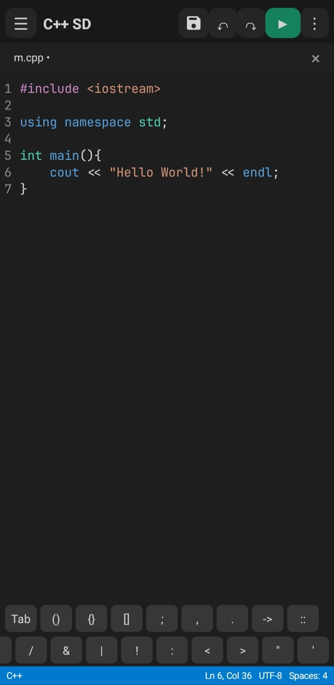
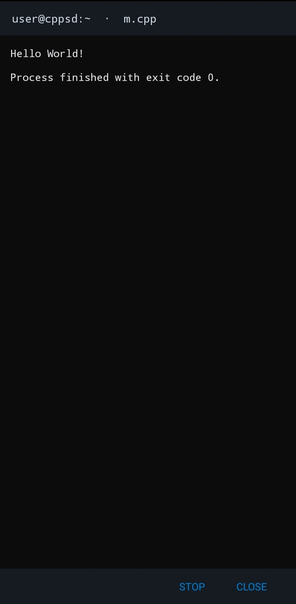
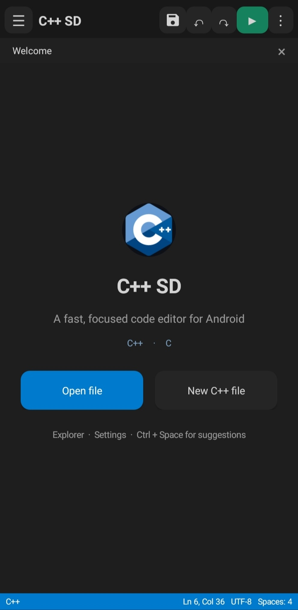

# C++ SD Android Downloads

Official public download page for **C++ SD**, an Android C/C++17 editor and compiler.

## Download

Download **C++ SD 1.4.2** from the [latest release](https://github.com/hamadax2/CppSD-Android/releases/tag/v1.4.2). This release is ARM64-only:

- **arm64-v8a** — modern 64-bit ARM phones; smallest native ARM64 toolchain build
- Signed release builds
- SHA-256 checksums included in `SHA256SUMS.txt`
- Fixed light mode with a consistent editor and gutter surface
- Synchronized gutter scrolling without horizontal overlay translation
- Supports C/C++ editing, Find/Replace, Format Code, code folding, autocomplete fallback, interactive terminal shell, and offline Clang tools
- Version 1.4.0 removes all third-party advertising code

## Screenshots

### C/C++ editor with code completion

The editor provides syntax highlighting, line numbers, code completion, and function signatures while writing C or C++ code.



### Compiler diagnostics and project browser

Compiler and language-server diagnostics are displayed directly over the source code, while the project browser provides quick access to files and folders.



### Editor and compiler settings

The Settings screen provides controls for dark mode, font size, word wrap, whitespace display, indentation, hidden files, and compiler options.



## Verify the checksum

```sh
sha256sum -c SHA256SUMS.txt
```

This is a **download-only repository**. Application source code is not included. For support, open an issue in this repository.
